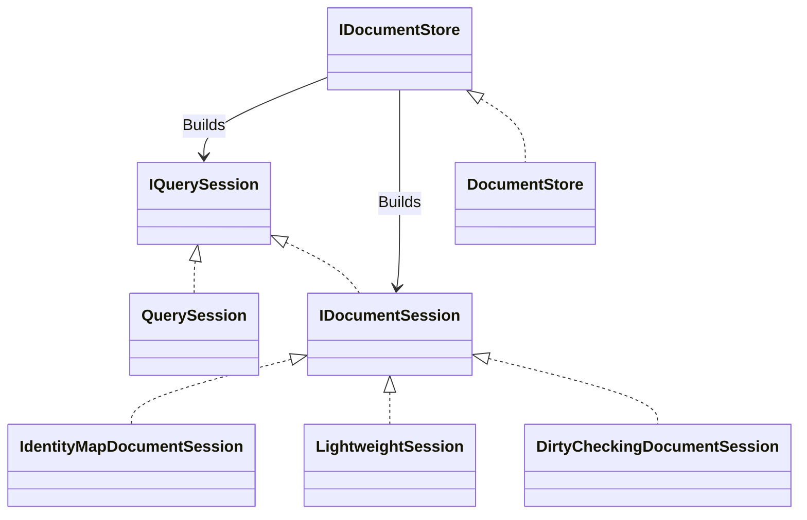

# Opening Sessions

`IDocumentStore` is the root of Marten usage, but most Marten usage in code will
start with one of the session types that can be created from an `IDocumentStore`. The following
diagram explains the relationship between the different flavors of session and the root store:



While there are sections below describing each session in more detail, at a high level the different
types of sessions are:

| **Creation**                                                  | **Read/Write** | **Identity Map**                               | **Dirty Checking**                             |
| ------------------------------------------------------------- | -------------- | ---------------------------------------------- | ---------------------------------------------- |
| `IDocumentStore.QuerySession()`                               | Read Only      | No                                             | No                                             |
| `IDocumentStore.QuerySerializableSessionAsync()`              | Read Only      | No                                             | No                                             |
| `IDocumentStore.LightweightSession()`                         | Read/Write     | No                                             | No                                             |
| `IDocumentStore.LightweightSerializableSessionAsync()`        | Read/Write     | No                                             | No                                             |
| `IDocumentStore.IdentitySession()`                            | Read/Write     | Yes                                            | No                                             |
| `IDocumentStore.IdentitySerializableSessionAsync()`           | Read/Write     | Yes                                            | No                                             |
| `IDocumentStore.DirtyTrackedSession()`                        | Read/Write     | Yes                                            | Yes                                            |
| `IDocumentStore.DirtyTrackedSerializableSessionAsync()`       | Read/Write     | Yes                                            | Yes                                            |
| `IDocumentStore.OpenSession(SessionOptions)`                  | Read/Write     | Set by `SessionOptions.Tracking` (default: No) | Set by `SessionOptions.Tracking` (default: No) |
| `IDocumentStore.OpenSerializableSessionAsync(SessionOptions)` | Read/Write     | Set by `SessionOptions.Tracking` (default: No) | Set by `SessionOptions.Tracking` (default: No) |

::: tip INFO
The recommended session type for read/write operations is `LightweightSession`, which gives the best performance. It does not do change tracking, which may not be needed for most cases.

For read-only access, use `QuerySession`.
:::

## Reaching the event store from a store-agnostic session <Badge type="tip" text="9.26" />

Marten's sessions implement the shared Critter Stack session contracts in `JasperFx.Events.Documents`,
which is what lets one body of code be compiled against Marten, Polecat or Fisher. As of 9.26 those
contracts carry an `Events` accessor, so a consumer holding a session as the shared contract can
reach the event store without naming a Marten type:

<!-- snippet: sample_shared_contract_session_events -->
<a id='snippet-sample_shared_contract_session_events'></a>
```cs
public async Task append_through_the_shared_contract(
    IDocumentSessionFactory factory, Guid streamKey, CancellationToken token)
{
    // The session was opened through the shared IDocumentSessionFactory, so nothing here
    // knows it is talking to Marten.
    await using var session = factory.LightweightSession();

    session.Events.StartStream<Order>(streamKey, new OrderPlaced("Acme", 100m));
    await session.SaveChangesAsync(token);
}
```
<sup><a href='https://github.com/JasperFx/marten/blob/master/src/DocumentDbTests/SessionMechanics/session_documentation_samples.cs#L20-L31' title='Snippet source file'>snippet source</a> | <a href='#snippet-sample_shared_contract_session_events' title='Start of snippet'>anchor</a></sup>
<!-- endSnippet -->

The split mirrors Marten's own: `IDocumentReadOperations.Events` is read-only
(`IQueryEventStore`), and `IDocumentSessionOperations.Events` adds appending
(`IEventStoreOperations`) — so a query session cannot append. Appends made through the accessor ride
the session's unit of work exactly as `Store()` does; nothing is written until `SaveChangesAsync`.

Nothing changes for code that holds a Marten session as `IQuerySession` / `IDocumentSession` — that
is the same `Events` property it always was.

### Reading what a session is about to append

`IDocumentSessionOperations.PendingStreams` exposes the `StreamAction`s a session has queued but not
yet committed — every `StartStream` and `Append` enlisted since the last `SaveChangesAsync`. It is
there for a listener or a pre-commit hook that needs to decide something from the events the session
is about to write, again without naming a store:

<!-- snippet: sample_shared_contract_pending_streams -->
<a id='snippet-sample_shared_contract_pending_streams'></a>
```cs
public async Task read_the_pending_streams(
    IDocumentSessionFactory factory, Guid streamKey, CancellationToken token)
{
    await using var session = factory.LightweightSession();

    session.Events.StartStream<Order>(streamKey, new OrderPlaced("Acme", 100m));

    // One StreamAction, carrying the OrderPlaced event, before anything is written
    foreach (var stream in session.PendingStreams)
    {
        // stream.ActionType is Start here. It would be Append against an existing stream
        Console.WriteLine($"{stream.ActionType} {stream.Id} with {stream.Events.Count} event(s)");
    }

    // PendingStreams is empty again afterwards
    await session.SaveChangesAsync(token);
}
```
<sup><a href='https://github.com/JasperFx/marten/blob/master/src/DocumentDbTests/SessionMechanics/session_documentation_samples.cs#L33-L51' title='Snippet source file'>snippet source</a> | <a href='#snippet-sample_shared_contract_pending_streams' title='Start of snippet'>anchor</a></sup>
<!-- endSnippet -->

Only the streams are exposed, deliberately — pending **document** operations are not part of the shared
contract. In Marten this is the same collection as `IDocumentSession.PendingChanges.Streams()`, and
it is a live view of the session rather than a snapshot, so copy it if you need stability across
further appends.

## Read Only QuerySession

For strictly read-only querying, the `QuerySession` is a lightweight session that is optimized
for reading. The `IServiceCollection.AddMarten()` configuration will set up a DI registration for
`IQuerySession`, so you can inject that into classes like this sample MVC controller:

<!-- snippet: sample_getissuecontroller -->
<a id='snippet-sample_getissuecontroller'></a>
```cs
public class GetIssueController: ControllerBase
{
    private readonly IQuerySession _session;

    public GetIssueController(IQuerySession session)
    {
        _session = session;
    }

    [HttpGet("/issue/{issueId}")]
    public Task<Issue> Get(Guid issueId)
    {
        return _session.LoadAsync<Issue>(issueId);
    }

    [HttpGet("/issue/fast/{issueId}")]
    public Task GetFast(Guid issueId)
    {
        return _session.Json.WriteById<Issue>(issueId, HttpContext);
    }

}
```
<sup><a href='https://github.com/JasperFx/marten/blob/master/src/AspNetCoreWithMarten/IssueController.cs#L55-L80' title='Snippet source file'>snippet source</a> | <a href='#snippet-sample_getissuecontroller' title='Start of snippet'>anchor</a></sup>
<!-- endSnippet -->

If you have an `IDocumentStore` object though, you can open a query session like this:

<!-- snippet: sample_opening_querysession -->
<a id='snippet-sample_opening_querysession'></a>
```cs
using var store = DocumentStore.For(opts =>
{
    opts.Connection("some connection string");
});

await using var session = store.QuerySession();

var badIssues = await session.Query<Issue>()
    .Where(x => x.Tags.Contains("bad"))
    .ToListAsync();
```
<sup><a href='https://github.com/JasperFx/marten/blob/master/src/Marten.Testing/Examples/OpeningAQuerySession.cs#L11-L24' title='Snippet source file'>snippet source</a> | <a href='#snippet-sample_opening_querysession' title='Start of snippet'>anchor</a></sup>
<!-- endSnippet -->

## Async session for serializable transactions

Use `IDocumentStore.LightweightSerializableSessionAsync()` to Open a new `IDocumentSession` with the supplied options and immediately open the database connection and start the transaction for the session. This is appropriate for Serializable transaction sessions.

<!-- snippet: sample_opening_session_async -->
<a id='snippet-sample_opening_session_async'></a>
```cs
await using var session =
    await store.LightweightSerializableSessionAsync(SessionOptions.ForConnectionString("another connection string"));

var openIssues = await session.Query<Issue>()
    .Where(x => x.Tags.Contains("open"))
    .ToListAsync();
```
<sup><a href='https://github.com/JasperFx/marten/blob/master/src/Marten.Testing/Examples/OpeningASessionAsync.cs#L17-L26' title='Snippet source file'>snippet source</a> | <a href='#snippet-sample_opening_session_async' title='Start of snippet'>anchor</a></sup>
<!-- endSnippet -->

## Identity Map Mechanics

**Identity Map:**

> Ensures that each object gets loaded only once by keeping every loaded object in a map. Looks up objects using the map when referring to them.
>
> -- <cite>[Martin Fowler](http://martinfowler.com/eaaCatalog/identityMap.html)</cite>

Marten's `IDocumentSession` implements the [_Identity Map_](https://en.wikipedia.org/wiki/Identity_map_pattern) pattern that seeks to cache documents loaded by id. This behavior can be very valuable, for example, in handling web requests or service bus messages when many different objects or functions may need to access the same logical document. Using the identity map mechanics allows the application to easily share data and avoid the extra database access hits -- as long as the `IDocumentSession` is scoped to the web request.

<!-- snippet: sample_using-identity-map -->
<a id='snippet-sample_using-identity-map'></a>
```cs
var user = new User { FirstName = "Tamba", LastName = "Hali" };
await theStore.BulkInsertAsync(new[] { user });

// Open a document session with the identity map
using var session = theStore.IdentitySession();
(await session.LoadAsync<User>(user.Id))
    .ShouldBeSameAs(await session.LoadAsync<User>(user.Id));
```
<sup><a href='https://github.com/JasperFx/marten/blob/master/src/Marten.Testing/Examples/IdentityMapTests.cs#L14-L22' title='Snippet source file'>snippet source</a> | <a href='#snippet-sample_using-identity-map' title='Start of snippet'>anchor</a></sup>
<!-- endSnippet -->

Do note that using the identity map functionality can be wasteful if you aren't able to take advantage of the identity map caching in a session. In those cases, you may want to either use the `IDocumentStore.LightweightSession()` which skips the identity map functionality, or use the read only `IQuerySession` alternative. To stop tracking a document, use `Eject()` (see below).

The Identity Map functionality is applied to all documents loaded by Id or Linq queries with `IQuerySession/IDocumentSession.Query<T>()`. **Documents loaded by user-supplied SQL in the `IQuerySession.QueryAsync<T>(sql)` mechanism bypass the Identity Map functionality.**

## Ejecting Documents from a Session

If for some reason you need to completely remove a document from a session's [identity map](#identity-map-mechanics) and [unit of work tracking](#unit-of-work-mechanics), use the
`IDocumentSession.Eject<T>(T document)` syntax shown below in one of the tests:

<!-- snippet: sample_ejecting_a_document -->
<a id='snippet-sample_ejecting_a_document'></a>
```cs
var target1 = Target.Random();
var target2 = Target.Random();

using (var session = theStore.IdentitySession())
{
    session.Store(target1, target2);

    // Both documents are in the identity map
    (await session.LoadAsync<Target>(target1.Id)).ShouldBeSameAs(target1);
    (await session.LoadAsync<Target>(target2.Id)).ShouldBeSameAs(target2);

    // Eject the 2nd document
    session.Eject(target2);

    // Now that 2nd document is no longer in the identity map
    (await session.LoadAsync<Target>(target2.Id)).ShouldBeNull();

    await session.SaveChangesAsync();
}

using (var session = theStore.QuerySession())
{
    // The 2nd document was ejected before the session
    // was saved, so it was never persisted
    (await session.LoadAsync<Target>(target2.Id)).ShouldBeNull();
}
```
<sup><a href='https://github.com/JasperFx/marten/blob/master/src/DocumentDbTests/SessionMechanics/ejecting_documents.cs#L16-L43' title='Snippet source file'>snippet source</a> | <a href='#snippet-sample_ejecting_a_document' title='Start of snippet'>anchor</a></sup>
<!-- endSnippet -->

To forget every document of one type at once, use `IDocumentSession.EjectAllOfType(Type)`. It removes the documents of
that type from the identity map and from dirty tracking, and drops the pending `Store()`, `Insert()` and `Update()`
operations for that exact type. Pending deletes and patches for the type, and everything queued for other types, are
left alone. A lightweight session has no identity map, so there it only drops the pending operations.

<!-- snippet: sample_docs_eject_all_of_type -->
<a id='snippet-sample_docs_eject_all_of_type'></a>
```cs
await using var session = store.IdentitySession();

session.Store(order);
session.Store(shop);

// Forget every ApiDocsOrder: out of the identity map, and the pending
// store/insert/update operations for that type are dropped
session.EjectAllOfType(typeof(ApiDocsOrder));

// Only the coffee shop is written
await session.SaveChangesAsync();
```
<sup><a href='https://github.com/JasperFx/marten/blob/master/src/Marten.Testing/Examples/DocumentApiDocsSamples.cs#L240-L254' title='Snippet source file'>snippet source</a> | <a href='#snippet-sample_docs_eject_all_of_type' title='Start of snippet'>anchor</a></sup>
<!-- endSnippet -->

## Ejecting all pending changes from a Session

If you want to remove all queued operations such as document changes or event operations in an unit of work, you can use `IDocumentSession.EjectAllPendingChanges()`. Note that calling this method will not impact any existing identity map i.e. all document stores. Here is a sample from one of our tests:

<!-- snippet: sample_ejecting_all_document_changes -->
<a id='snippet-sample_ejecting_all_document_changes'></a>
```cs
theSession.Store(Target.Random());
theSession.Insert(Target.Random());
theSession.Update(Target.Random());

theSession.PendingChanges.Operations().Any().ShouldBeTrue();

theSession.EjectAllPendingChanges();

theSession.PendingChanges.Operations().Any().ShouldBeFalse();
```
<sup><a href='https://github.com/JasperFx/marten/blob/master/src/DocumentDbTests/SessionMechanics/ejecting_all_pending_changes.cs#L19-L29' title='Snippet source file'>snippet source</a> | <a href='#snippet-sample_ejecting_all_document_changes' title='Start of snippet'>anchor</a></sup>
<!-- endSnippet -->

## Connection Handling

::: tip
Since Marten 7, a session opens a connection only for each operation. Keep Npgsql connection pooling on (it is by default).
:::

By default, Marten will only open a database connection within a session immediately before any operation that involves
a database connection, and closes that connection immediately after the operation is over (really just returning the underlying
connection to the connection pool managed by Npgsql). With this change, it is now safe to run read-only queries through
`IQuerySession` (or lightweight `IDocumentSession`) objects in multiple threads. That should make Marten be more effective
within [Hot Chocolate integrations](https://chillicream.com/docs/hotchocolate/v13).

There are some exceptions to this behavior:

1. When creating a session with an existing connection or transaction
2. When creating a session with serializable transaction isolation levels, the connection is opened immediately and sticky throughout. I.e., the `*SerializableSessionAsync()` methods
3. When opting to have Marten enroll in ambient transactions (`SessionOptions.ForCurrentTransaction()`)
4. When choosing to use explicit transaction boundaries (see the next section)
5. When using the session's underlying connection for user defined querying (`GetConnectionAsync()`).

::: info
This ability to directly access and use the session's connection was originally intended to make Marten easy to integrate
with [Dapper](https://github.com/DapperLib/Dapper).
:::

To the last point, using this code will quietly move the session to having a "sticky" connection. Marten 10 replaced the
synchronous `IQuerySession.Connection` property with `GetConnectionAsync()`:

<!-- snippet: sample_using_session_connection_directly -->
<a id='snippet-sample_using_session_connection_directly'></a>
```cs
public static async Task using_session_connection(IQuerySession session)
{
    // GetConnectionAsync() opens a "sticky" connection for the session
    // if it does not already have one. The session owns it, so don't dispose it
    var connection = await session.GetConnectionAsync();

    // This is using a helper extension method from Weasel
    var openCount = await connection
        .CreateCommand("select count(*) from tasks where status = 'open'")
        .ExecuteScalarAsync();
}
```
<sup><a href='https://github.com/JasperFx/marten/blob/master/src/Marten.Testing/Examples/ExplicitTransactions.cs#L11-L25' title='Snippet source file'>snippet source</a> | <a href='#snippet-sample_using_session_connection_directly' title='Start of snippet'>anchor</a></sup>
<!-- endSnippet -->

You can register SQL statements to be executed as part of the `SaveChangesAsync()` batch and transaction through
`IDocumentSession.QueueSqlCommand()`, and the Marten team would recommend doing that as much as possible.

### Explicit Transaction Boundaries

::: warning
If you use this method, you will want to make sure the session is disposed to release the "sticky" connection.
:::

Sometimes you may want to start the transaction in a Marten session for making explicit commits through the session's
connection (with Dapper for example) or if you simply need to have consistent reads within the usage of the session
by querying through an active transaction. In that case, your syntax is:

<!-- snippet: sample_explicit_transactions -->
<a id='snippet-sample_explicit_transactions'></a>
```cs
public static async Task explicit_transactions(IDocumentSession session)
{
    // Opens the session's connection and begins its transaction. There is no
    // synchronous BeginTransaction() as of Marten 10
    await session.BeginTransactionAsync(CancellationToken.None);
}
```
<sup><a href='https://github.com/JasperFx/marten/blob/master/src/Marten.Testing/Examples/ExplicitTransactions.cs#L28-L37' title='Snippet source file'>snippet source</a> | <a href='#snippet-sample_explicit_transactions' title='Start of snippet'>anchor</a></sup>
<!-- endSnippet -->

### "Sticky" Connections

Marten 10 removed the `UseStickyConnectionLifetimes` option that brought back the V6 and earlier "sticky" connection
handling for every session. When one session needs to hold a single connection until it is disposed, for example
for a serializable transaction, call `BeginTransactionAsync()` or `GetConnectionAsync()` on that session, or open it
with `OpenSerializableSessionAsync()`. Either way, it's imperative that the session is disposed so the connection goes
back to the pool.

There is no place within Marten where it keeps a stateful connection open across sessions.

## Command Timeouts

By default, Marten just uses the underlying timeout configuration from the [Npgsql connection string](http://www.npgsql.org/doc/connection-string-parameters.html).
You can though, opt to set a different command timeout per session with this syntax:

<!-- snippet: sample_configurecommandtimeout -->
<a id='snippet-sample_configurecommandtimeout'></a>
```cs
public void ConfigureCommandTimeout(IDocumentStore store)
{
    // Overrides the store's command timeout for this session,
    // setting it to 60 seconds
    using (var session = store.LightweightSession(new SessionOptions { Timeout = 60 }))
    {
    }
}
```
<sup><a href='https://github.com/JasperFx/marten/blob/master/src/CoreTests/SessionOptionsTests.cs#L23-L34' title='Snippet source file'>snippet source</a> | <a href='#snippet-sample_configurecommandtimeout' title='Start of snippet'>anchor</a></sup>
<!-- endSnippet -->

### How the effective timeout is resolved

For any given session, the timeout is the first of these that has an opinion:

1. `SessionOptions.Timeout`, if you set one for that session.
2. `StoreOptions.CommandTimeout`, if you set it deliberately — either by assigning it, or by passing a connection
   string to `StoreOptions.Connection(...)`. That uses the string's `Command Timeout`, or Npgsql's default of 30
   seconds when there is none.
3. The `Command Timeout` on the connection string of **the database this session is actually working against**.
4. Marten's own default of 5 seconds.

Step 3 matters under multi-database tenancy. There is no single connection string in that setup, so the shard
connection strings never reach `StoreOptions.Connection(...)` and step 2 never fires — which used to mean a
`Command Timeout=300` on every shard was ignored and every command ran with a 5 second budget, with nothing
reporting that the setting had no effect. Since [#5269](https://github.com/JasperFx/marten/issues/5269) the
database being used has a say.

::: tip
Note that step 2 still beats step 3. Assigning `StoreOptions.CommandTimeout` is a store-wide instruction, so it
is not overridden by whatever an individual shard's connection string happens to carry. If you want per-shard
timeouts, put them on the shard connection strings and leave `StoreOptions.CommandTimeout` alone.
:::

## Unit of Work Mechanics

::: tip
The call to `IDocumentSession.SaveChangesAsync()` tries to batch all the queued updates and deletes into a single ADO.Net call to PostgreSQL. Our testing has
shown that this technique is much faster than issuing one ADO.Net call at a time.
:::

At this point, the `IDocumentSession` is the sole [unit of work](http://martinfowler.com/eaaCatalog/unitOfWork.html) for transactional updates -- but that may change later as Marten outgrows its origin as a replacement for RavenDb. As [shown before](/documents/), document sessions come in three flavors (lightweight, identity map tracking, and identity map + dirty checking), but there are only two modes of change tracking:

1. Lightweight and the standard "identity map" sessions require users to do all the change tracking manually and tell the `IDocumentSession`
   what documents have changed
1. The "dirty checking" session tries to determine which documents loaded from that `IDocumentSession` has any changes when `IDocumentSession.SaveChangesAsync()` is called

::: tip INFO
When using a `Guid`, `int`, or `long` identifier, Marten will ensure the identity is set immediately after calling `IDocumentSession.Store` on the entity.
:::

Nothing is written until you call `SaveChangesAsync()`, which sends every queued operation in one batch and one transaction.

## Adding Listeners

See [Diagnostics and Instrumentation](/diagnostics) for information about using document session listeners.
To add a listener to one session only, use `SessionOptions.ListenAt()`, shown in the next section.

## More Session Options

`SessionOptions` has a few fluent helpers and switches beyond the ones shown elsewhere on this page:

<!-- snippet: sample_docs_session_options_helpers -->
<a id='snippet-sample_docs_session_options_helpers'></a>
```cs
var options = new SessionOptions
    {
        // Open a session for the default tenant even when
        // StoreOptions.Advanced.DefaultTenantUsageEnabled is false
        AllowAnyTenant = true
    }
    // Same as setting SessionOptions.Tracking
    .WithTracking(DocumentTracking.IdentityOnly)
    // A listener for this session only, on top of the store-wide StoreOptions.Listeners
    .ListenAt(auditListener);

await using var session = store.OpenSession(options);
```
<sup><a href='https://github.com/JasperFx/marten/blob/master/src/Marten.Testing/Examples/DocumentApiDocsSamples.cs#L220-L235' title='Snippet source file'>snippet source</a> | <a href='#snippet-sample_docs_session_options_helpers' title='Start of snippet'>anchor</a></sup>
<!-- endSnippet -->

* `AllowAnyTenant` lets the session open for the default tenant on a store with
  `StoreOptions.Advanced.DefaultTenantUsageEnabled = false`, which otherwise throws `DefaultTenantUsageDisabledException`
  (see [multi-tenancy](/documents/multi-tenancy)). Database-per-tenant configurations turn that setting off for you.
* `WithTracking(DocumentTracking)` sets `SessionOptions.Tracking` and returns the options. `None` is a lightweight
  session, `IdentityOnly` an identity session and `DirtyTracking` a dirty-tracked session.
* `ListenAt(IDocumentSessionListener)` adds a listener for this session only. The session gets the store's listeners
  from `StoreOptions.Listeners` and then these.
* `ConcurrencyChecks` turns optimistic concurrency checks off for the session. See
  [optimistic concurrency](/documents/concurrency#turning-off-the-checks-for-one-session).

## Enlisting in Existing Transactions

::: warning
Marten is unable to evaluate database migrations within a session that is created by enrolling in an ambient transaction
(`TransactionScope`). If you need to use ambient transactions, you will need to apply database changes upfront.
:::

You can pass in an existing connection or transaction, or enlist in an ambient `TransactionScope`, and choose whether
`SaveChangesAsync()` commits the transaction.

<!-- snippet: sample_passing-in-existing-connections-and-transactions -->
<a id='snippet-sample_passing-in-existing-connections-and-transactions'></a>
```cs
// Use an existing connection, but Marten still controls the transaction lifecycle
var session1 = store.LightweightSession(SessionOptions.ForConnection(connection));

// Enlist in an existing Npgsql transaction, but
// choose not to allow the session to own the transaction
// boundaries
var session3 = store.LightweightSession(SessionOptions.ForTransaction(transaction));

// Enlist in the current, ambient transaction scope
using var scope = new TransactionScope();
var session4 = store.LightweightSession(SessionOptions.ForCurrentTransaction());
```
<sup><a href='https://github.com/JasperFx/marten/blob/master/src/StressTests/ability_to_use_an_existing_connection_and_transaction.cs#L48-L63' title='Snippet source file'>snippet source</a> | <a href='#snippet-sample_passing-in-existing-connections-and-transactions' title='Start of snippet'>anchor</a></sup>
<!-- endSnippet -->

## Transaction Isolation Level

The transaction isolation level when opening a new `IDocumentSession` can be configured by
supplying the optional `isolationLevel` argument. The default level is `ReadCommitted`.

::: warning
In Marten 10, passing `IsolationLevel.Serializable` to `LightweightSession()`, `IdentitySession()`,
`DirtyTrackedSession()` or `OpenSession()` throws `NotSupportedException`. Open serializable sessions with the matching
`*SerializableSessionAsync()` method.
:::

As one of the use cases that spawned this feature, say that you are using the [Saga pattern](https://lostechies.com/jimmybogard/2013/03/21/saga-implementation-patterns-variations/) in a service bus architecture. When handling a message with this pattern, you typically want to load some kind of persisted state for the long running saga, do some work, then persist the updated saga state.

If you need to worry about serializing the messages for a single saga, you might want to use [serializable transactions](https://en.wikipedia.org/wiki/Serializability) like this:

<!-- snippet: sample_serializable-saga-transaction -->
<a id='snippet-sample_serializable-saga-transaction'></a>
```cs
public class MySagaState
{
    public Guid Id { get; set; }
}

public async Task execute_saga_serializable(IDocumentStore store, Guid sagaId, CancellationToken ct)
{
    // The session below will open its connection and start a
    // serializable transaction avoiding blocking calls
    await using var session = await store.LightweightSerializableSessionAsync(ct);
    var state = await session.LoadAsync<MySagaState>(sagaId, ct);

    // do some work against the saga

    await session.SaveChangesAsync(ct);
}
```
<sup><a href='https://github.com/JasperFx/marten/blob/master/src/Marten.Testing/Examples/SagaStorageExample.cs#L10-L29' title='Snippet source file'>snippet source</a> | <a href='#snippet-sample_serializable-saga-transaction' title='Start of snippet'>anchor</a></sup>
<!-- endSnippet -->

You may also specify other [transaction isolation level supported by PostgreSQL](https://www.postgresql.org/docs/current/transaction-iso.html):

<!-- snippet: sample_saga-transaction -->
<a id='snippet-sample_saga-transaction'></a>
```cs
public async Task execute_saga(IDocumentStore store, Guid sagaId, CancellationToken ct)
{
    // The session below uses a snapshot transaction
    await using var session = store.LightweightSession(IsolationLevel.Snapshot);
    var state = await session.LoadAsync<MySagaState>(sagaId, ct);

    // do some work against the saga

    await session.SaveChangesAsync(ct);
}
```
<sup><a href='https://github.com/JasperFx/marten/blob/master/src/Marten.Testing/Examples/SagaStorageExample.cs#L31-L44' title='Snippet source file'>snippet source</a> | <a href='#snippet-sample_saga-transaction' title='Start of snippet'>anchor</a></sup>
<!-- endSnippet -->

## Manual Change Tracking

The first step is to create a new `DocumentSession` with the `IDocumentStore.LightweightSession()`:

<!-- snippet: sample_lightweight_document_session_uow -->
<a id='snippet-sample_lightweight_document_session_uow'></a>
```cs
await using var session = store.LightweightSession();
var user = new User { FirstName = "Jeremy", LastName = "Miller" };

// Manually adding the new user to the session
session.Store(user);

var existing = await session.Query<User>().SingleAsync(x => x.FirstName == "Max");
existing.Internal = false;

// Manually marking an existing user as changed
session.Store(existing);

// Marking another existing User document as deleted
session.Delete<User>(Guid.NewGuid());

// Persisting the changes to the database
await session.SaveChangesAsync();
```
<sup><a href='https://github.com/JasperFx/marten/blob/master/src/Marten.Testing/Examples/UnitOfWorkMechanics.cs#L12-L30' title='Snippet source file'>snippet source</a> | <a href='#snippet-sample_lightweight_document_session_uow' title='Start of snippet'>anchor</a></sup>
<!-- endSnippet -->

Do note that Marten's `Store()` method makes no distinctions between inserts and updates. Marten writes it as an "upsert", an `insert ... on conflict ... do update` statement against the document table. Anytime a document is registered through `IDocumentSession.Store(document)`, Marten runs the "auto-assignment" policy for the id type of that document. See [identity](/documents/identity) for more information on document id's.

## Automatic Dirty Checking Sessions

In the case an `IDocumentSession` opened with the dirty checking enabled, the session will try to detect changes to any of the documents loaded by that
session. When the session loads a document, it serializes the document and keeps that JSON. When `SaveChangesAsync()` is called,
it serializes the document again and compares the two strings, and any document whose JSON changed is written.

The comparison is of the serialized text, so a document whose serialization is not stable from one call to the next, a
`Dictionary` whose keys come out in a different order for example, is written again even though nothing changed. That
costs an extra write, never a lost change.

<!-- snippet: sample_tracking_document_session_uow -->
<a id='snippet-sample_tracking_document_session_uow'></a>
```cs
await using var session = store.DirtyTrackedSession();
var user = new User { FirstName = "Jeremy", LastName = "Miller" };

// Manually adding the new user to the session
session.Store(user);

var existing = await session.Query<User>().SingleAsync(x => x.FirstName == "Max");
existing.Internal = false;

// Marking another existing User document as deleted
session.Delete<User>(Guid.NewGuid());

// Persisting the changes to the database
await session.SaveChangesAsync();
```
<sup><a href='https://github.com/JasperFx/marten/blob/master/src/Marten.Testing/Examples/UnitOfWorkMechanics.cs#L35-L50' title='Snippet source file'>snippet source</a> | <a href='#snippet-sample_tracking_document_session_uow' title='Start of snippet'>anchor</a></sup>
<!-- endSnippet -->

Do be aware that the automated dirty checking comes with some mechanical cost in memory and runtime performance.
